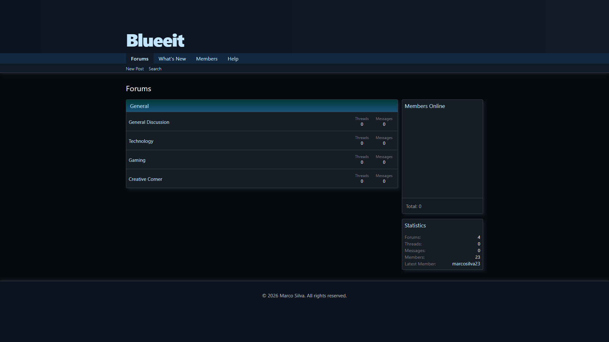
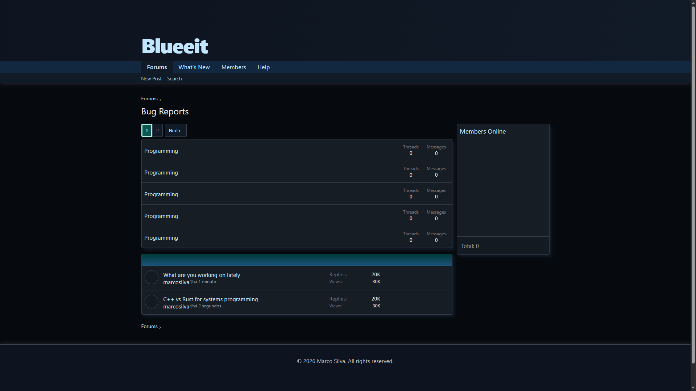
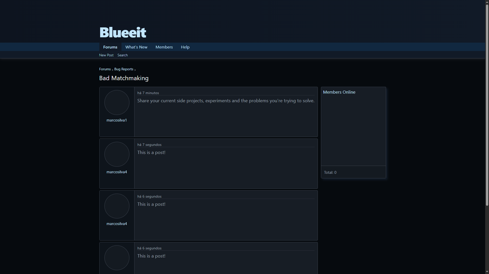
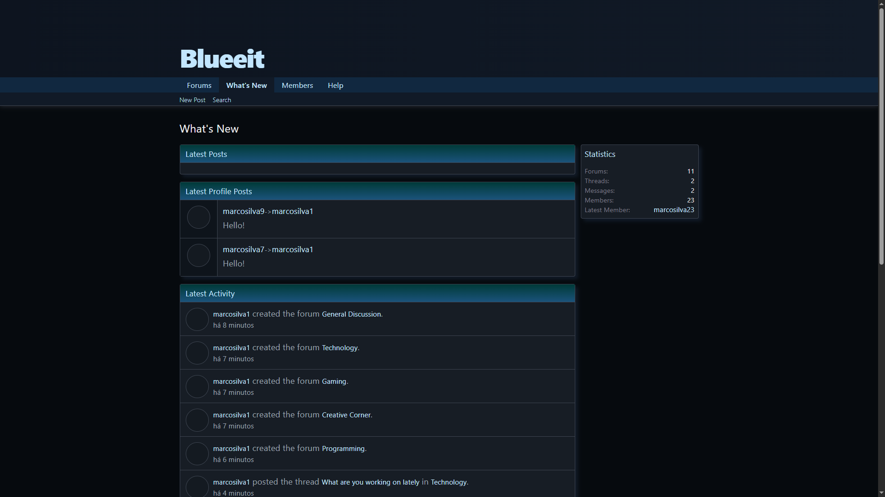
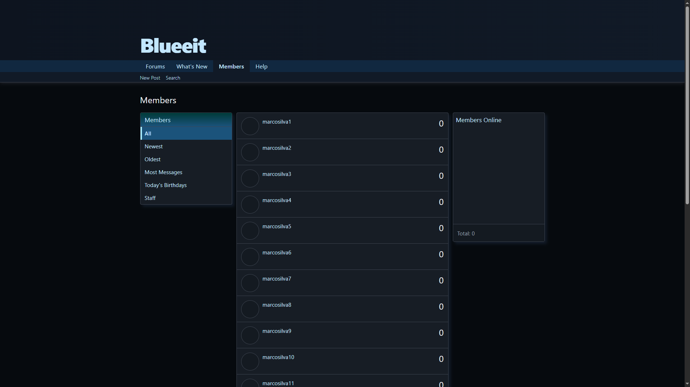
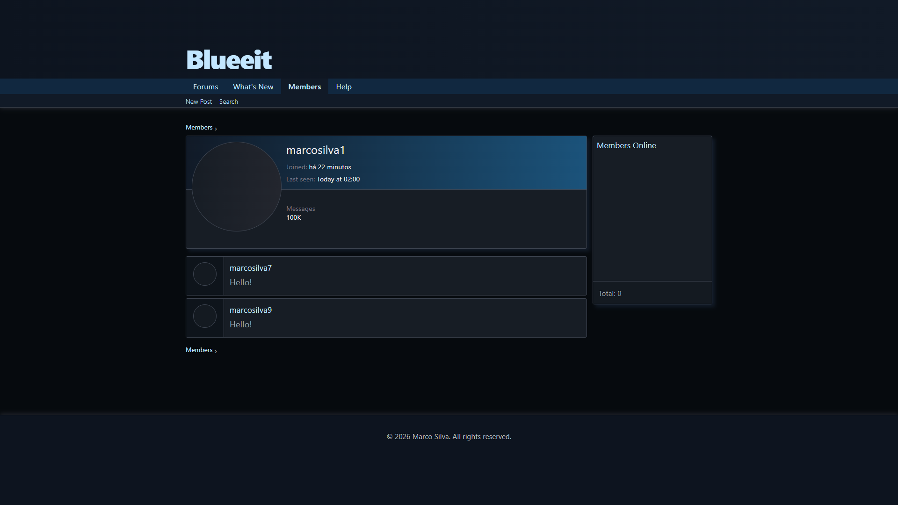

# Blueeit
Blueeit is a forum web application developed as a personal project to explore full-stack web development, REST APIs, and software architecture.

## Features
* Forum and subforum navigation
* Thread and post browsing
* Member listings and sorting
* User activity
* Profile posts
* Pagination

## Roadmap
- [ ] Request and model validation
- [ ] User authentication and authorization
- [ ] Forum, thread and post creation from the frontend
- [ ] Online members sidepanel
- [ ] PostgreSQL database integration using EF (Entity Framework)
- [ ] Automated tests

## Technology Stack

### Frontend
* React
* JavaScript
* Vite

### Backend
* C# / ASP.NET Core Web API
* REST APIs
* In-memory services

## Architecture
The project is divided into two main components:

* **Client/Blueeit.Web:** React web application
* **Server/Blueeit.Api:** ASP.NET Core API

The frontend communicates with the backend through HTTP requests. The backend organizes application logic into services and exposes endpoints for retrieving and managing data.

## Prerequisites
Before running Blueeit locally, make sure you have the following installed:

* .NET 10.0 SDK
* Node.JS (LTS)
* npm
* Git

## Running Locally

### 1. Clone the repository
```console
$ git clone https://github.com/msilva2203/Blueeit.git
$ cd Blueeit
```

### 2. Start the backend
Open a terminal in Server/Blueeit.Api/ and run:
```console
$ dotnet restore
$ dotnet run
```

### 3. Start the frontend
Open a terminal in Client/Blueeit.Web/ and run:
```console
$ npm install
$ npm run dev
```

Open http://localhost:5173/ in your browser.

## Project Status
Blueeit is a work in progress. Features and architecture are being developed incrementally as part of an ongoing learning project.

## Screenshots

### Forums


### Forum details


### Thread


### Whats-New page


### Members page


### Member Profile

